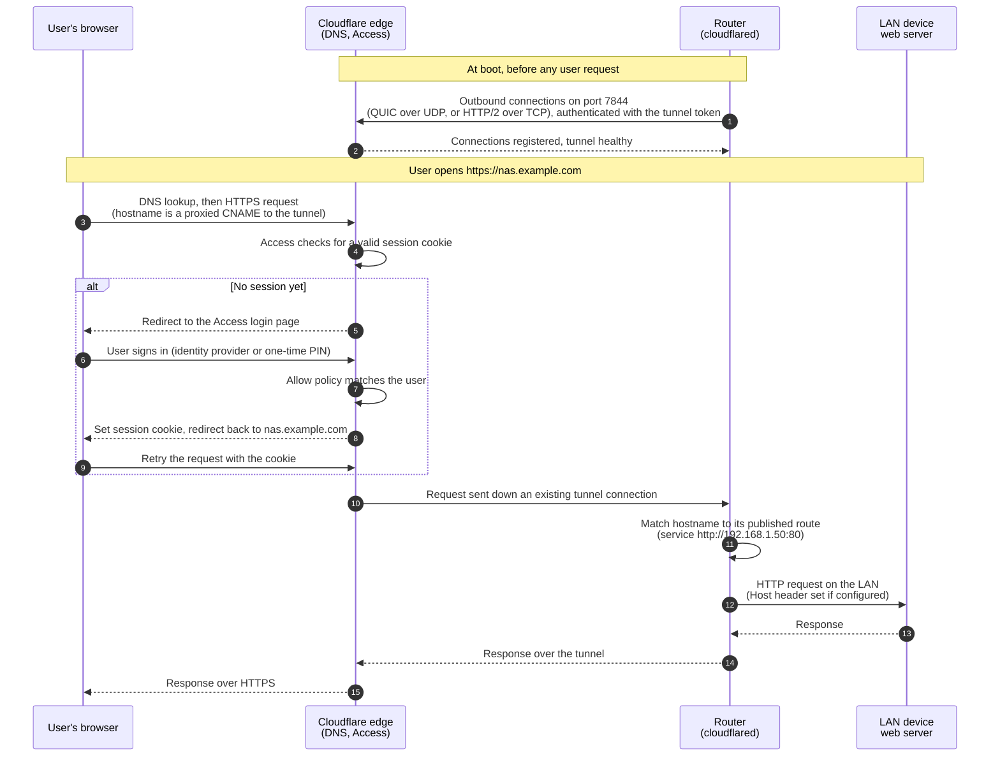

# cloudflared for RutOS

Unofficial opkg packages of the unmodified upstream [`cloudflared`](https://github.com/cloudflare/cloudflared) for Teltonika RutOS routers. You can reach the router's WebUI, and web UIs on its LAN, through a Cloudflare Tunnel behind Cloudflare Access. It needs no inbound ports and works behind CGNAT.

| Package | Router | Status on RutOS 7.26.1 |
| --- | --- | --- |
| `cloudflared_<version>_mips32el-nf.ipk` | RUTM50 (and other little-endian MIPS RutOS devices) | Tested |
| `cloudflared_<version>_armv7ahf-vfp.ipk` | RUTX11 (and other ARMv7 RutOS devices) | Built, not yet tested on hardware |

Run `opkg print-architecture` on the router. Pick the package whose arch is in that list.

This package runs a *remotely managed* tunnel: you set up routes in the Cloudflare dashboard, and the router only holds a token. It's not the Cloudflare One Client (WARP), which can't run on RutOS.

## How a request reaches a LAN device

The router opens outbound connections to Cloudflare, so nothing listens on the WAN side. Every browser request is checked by Access at Cloudflare's edge before it's sent down the tunnel.



For the router's own WebUI, the route's service is `https://127.0.0.1:443`, so the last hop never leaves the router.

## Cloudflare setup

You need a domain that's active on Cloudflare. Do the steps in this order, so a hostname is never reachable without Access in front of it.

1. **Create the tunnel.** In the dashboard, go to **Networking → Tunnels → Create a tunnel**. Name it after the router and select **Create Tunnel**. Copy the installation command it shows for any OS, but don't run it. The token is the `eyJ...` string in that command. You can get it again later from the tunnel's **Add a replica** button.
2. **Protect each hostname with Access.** Go to **Zero Trust → Access controls → Applications → Create new application → Self-hosted and private → Add public hostname**. Enter the hostname you're about to publish, for example `router.example.com`, and add an Allow policy for the people who should get in. Access applications deny everyone by default.
3. **Publish the route.** In the tunnel, go to the **Routes** tab, then **Add route → Published application**. Enter the same subdomain and domain, then the **Service URL**:
   - **Router WebUI:** `https://127.0.0.1:443`. The router's certificate is self-signed, so under **Additional application settings → TLS**, turn on **Disable TLS certificate verification**. Cloudflare recommends that only as a last resort, but here the unverified hop never leaves the router.
   - **A LAN device:** its LAN address, for example `http://192.168.1.50:80`. If its UI breaks or redirects to its IP, set **Additional application settings → HTTP → HTTP Host Header** to the name it expects. If it redirects HTTP to HTTPS, use its `https://` address instead, or the browser gets `ERR_TOO_MANY_REDIRECTS`.

Never publish a route without an Access application in front of it. Every hostname is an admin login.

The router only needs outbound port 7844 (UDP for QUIC, TCP for HTTP/2). It needs no inbound firewall rules and works behind CGNAT.

## Install

Download the right `.ipk` and `SHA256SUMS` from the [releases](../../releases) page, then:

```sh
sha256sum -c --ignore-missing SHA256SUMS
scp -O cloudflared_*_<arch>.ipk root@<router>:/tmp/
ssh root@<router>
opkg install /tmp/cloudflared_*.ipk && rm /tmp/cloudflared_*.ipk
```

Configure and start it:

```sh
uci set cloudflared.main.token='<token>'
uci set cloudflared.main.enabled='1'
uci commit cloudflared
/etc/init.d/cloudflared restart
logread -e cloudflared        # look for "Registered tunnel connection"
```

The tunnel then shows as *Healthy* in the dashboard and starts by itself at boot.

## Settings

`/etc/config/cloudflared`:

| Option | Default | Values |
| --- | --- | --- |
| `enabled` | `0` | `1` runs the tunnel |
| `token` | empty | tunnel token from the dashboard |
| `protocol` | `auto` | `auto`, `quic`, `http2`. `auto` uses QUIC and falls back to HTTP/2 if UDP fails. Force `http2` if the mobile carrier throttles UDP 7844 |
| `loglevel` | `info` | `debug`, `info`, `warn`, `error`, `fatal`. `debug` logs request headers, which can include cookies, so don't leave it on |

After `uci commit cloudflared`, the service restarts with the new settings.

## Upgrade, rotate, remove

- **Upgrade:** install the newer `.ipk` the same way. Your settings are kept.
- **Rotate the token.** Anyone with the token can run your tunnel, so rotate it now and then, and right away if it leaks. In **Networking → Tunnels**, select the tunnel, then **Rotate token**. Copy the new token from **Add a replica**, then run `uci set cloudflared.main.token='<new token>'` and `uci commit cloudflared`. The commit restarts the service. A connector that's already running keeps working on the old token until it restarts. If the token leaked, also force-disconnect the old connections with the [API](https://developers.cloudflare.com/tunnel/reference/tunnel-tokens/#rotate-a-token).
- **Remove:** `opkg remove cloudflared`.
- **After a firmware upgrade, reinstall the package.** A RutOS firmware upgrade removes all packages you installed yourself, cloudflared included, so the tunnel stays down until you reinstall. If you ticked *Keep settings*, your config and token in `/etc/config/cloudflared` are kept. Install the `.ipk` again as described under [Install](#install). opkg keeps your existing config (it prints *Existing conffile … is different*, which is expected), and the tunnel starts again on its own. Check with `logread -e cloudflared | grep Registered`.
- **Compare before and after an upgrade:** [`tools/fwcheck.sh`](tools/fwcheck.sh) takes a read-only snapshot of the package, config, service and tunnel. It never prints the token.

  ```sh
  ssh root@<router> sh -s pre  < tools/fwcheck.sh > fwcheck-pre.txt
  # upgrade the firmware with "Keep settings" ticked
  ssh root@<router> sh -s post < tools/fwcheck.sh > fwcheck-post.txt
  diff fwcheck-pre.txt fwcheck-post.txt
  ```

## Building

You need Go and git. `build.sh` uses the exact Go version upstream pins.

```sh
./build.sh 2026.11.0                    # out/cloudflared-armv7, out/cloudflared-mipsle
./mkipk.sh 2026.11.0 armv7              # out/cloudflared_2026.11.0-r1_armv7ahf-vfp.ipk
./mkipk.sh 2026.11.0 mipsle
./check.sh 2026.11.0 out/*.ipk          # also runs the binaries if qemu-user-static is installed
```

Targets are listed in [`targets`](targets). Releases are built by [`.github/workflows/release.yml`](.github/workflows/release.yml), which runs daily and packages any new upstream release. To ship a packaging-only fix, run the workflow by hand with `pkgrel` bumped.

See [PLAN.md](PLAN.md) for the design and roadmap. Phase 2 adds a RutOS WebUI page.

## License

`cloudflared` is © Cloudflare, Apache-2.0. Its license ships in the package at `/usr/share/licenses/cloudflared/LICENSE`. This project isn't affiliated with Cloudflare or Teltonika.
